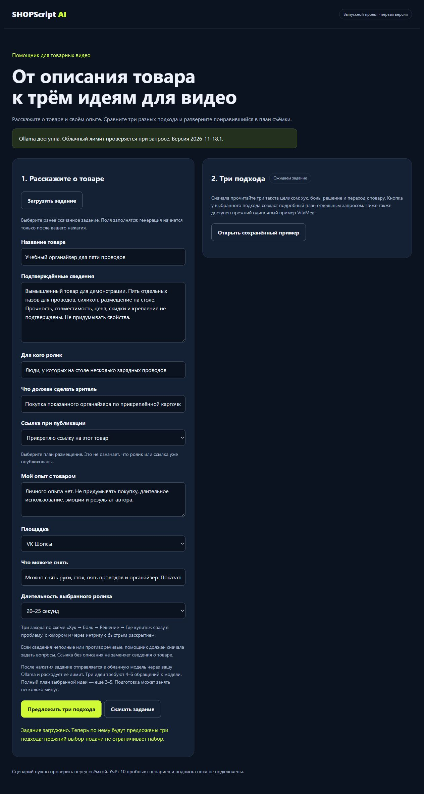
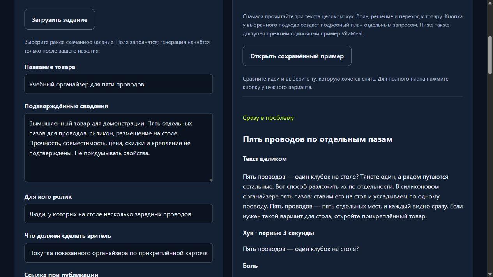
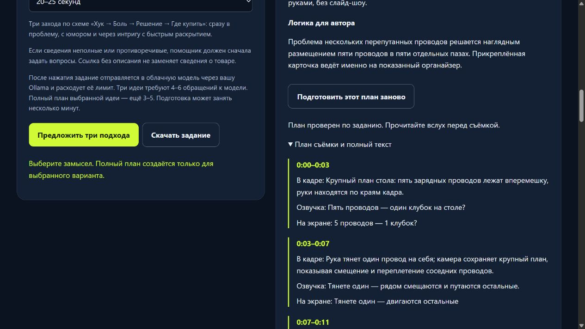

# SHOPScript

Помощник для подготовки сценариев коротких товарных видео. Автор — Алексей. Версия приложения: 2026-11-18.1. Документация обновлена 20 ноября 2026 года.

## Задача и пользователь

Авторы товарных роликов подбирают начало, формулируют проблему зрителя, находят понятный способ показать решение и подводят к покупке. SHOPScript помогает подготовить три черновика по одному заданию и развернуть выбранный вариант в план съёмки. Целевые пользователи — авторы VK Шопсов, блогеры и продавцы.

Цель ролика — покупка показанного товара по прикреплённой ссылке. Переход — промежуточное действие. Приложение не гарантирует удержание, переходы или продажи.

## Что работает

- Ввод сведений о товаре, аудитории, цели, личном опыте и доступной съёмке.
- Загрузка и сохранение задания в JSON без запуска модели при импорте.
- Три захода по схеме «Хук → Боль → Решение → Где купить»: сразу в проблему, разговорный юмор и интрига с быстрым раскрытием.
- Просмотр текста целиком и по этапам, копирование и скачивание результата.
- Отдельное создание полного плана выбранного варианта: кадры, озвучка, надписи и подпись.
- Проверка полноты данных, структуры ответа, таймкодов, объёма озвучки и замечаний редактора. После одной доработки оставшиеся замечания показываются пользователю.

## Состояние MVP

Локальное приложение работает. Проведены технические проверки и тесты с реальным пользователем. Пользователь отверг первые сценарии; по его замечаниям изменены структура и темп. Последние дерзкие формулировки доработаны вручную, понравились автору проекта и отправлены пользователю. Их одобрения, снятого ролика и статистики покупок пока нет. Автоматический статус ready означает проверку по правилам, а не согласование заказчиком. Генерация пока требует редакторской работы.

## Запуск

Нужны Python 3.10+ и установленная Ollama с входом в облачный аккаунт, доступом к `kimi-k3.1-pro:cloud` и достаточным лимитом. Интернет нужен для новой генерации. Дополнительные Python-пакеты для приложения не нужны.

1. Распакуйте проект и запустите Ollama. Войдите в свой аккаунт средствами Ollama.
2. Откройте «Открыть SHOPScript.cmd» в Windows. Он проверяет версию приложения. Если встроенного в среду Python нет, используется Python из PATH.
3. Либо откройте терминал в папке проекта и выполните `python -B server.py`.
4. Откройте http://127.0.0.1:8789/ . Остановка сервера в терминале — Ctrl+C.

Проверка: http://127.0.0.1:8789/api/status должна вернуть `app_version: 2026-11-18.1`. При старой версии остановите свой старый сервер и запустите заново. Не завершайте посторонние процессы на занятом порте. Можно выбрать иной порт командой `python -B server.py --port 8790` и открыть соответствующий адрес.

## Учебное задание

Файл [examples/demo-brief.json](examples/demo-brief.json) содержит вымышленный органайзер для проводов, без личных данных. Загрузите его кнопкой «Загрузить задание». Нажатие «Предложить три подхода» отправит данные облачной модели. Результат не предрешён: могут появиться вопросы или замечания. Сохранённый VitaMeal в интерфейсе — архивный одиночный пример, не результат текущей схемы.

## Стоимость и данные

Три подхода требуют 4–6 последовательных запросов к модели; полный план выбранного — ещё 3–5. Уточняющий ответ может завершить процесс раньше. Запросы расходуют облачный лимит. Приложение не выполняет автоматический повтор после сетевой ошибки.

Сервер слушает только 127.0.0.1. Ключи не вводятся в браузере и не входят в проект. Запросы используют авторизацию локальной Ollama. Сервер не ведёт историю заданий. При генерации поля формы передаются облачной модели. Результат JSON содержит исходное задание и развёрнутые варианты: проверьте его перед передачей другим людям. Импорт и просмотр архивного примера не обращаются к модели.

## Как устроено

Python использует стандартную библиотеку; интерфейс — HTML, CSS и JavaScript. `server.py` выполняет роли исследователя, планировщика, сценариста и редактора последовательными запросами к одной модели Ollama. Это не параллельные субагенты Claude Code. Формат обмена — JSON. Исходные сведения и ссылки автоматически не проверяются во внешних источниках.

- `public/` — интерфейс и архивный пример.
- `server.py`, `start.py` — сервер и запуск с проверкой версии.
- [Инструкция пользователя](docs/USER-GUIDE.md).
- [Подготовка к сдаче](docs/RELEASE-GUIDE.md).
- [Скилл сопровождения](.claude/skills/shopscript-maintenance/SKILL.md).
- `tests/` — локальные проверки и отдельный облачный тест редактора.
- `scripts/build_release.py` — сборка архива по явному списку файлов.

## Проверки

`python -m unittest discover -s tests -p test_server.py -v`

21 проверка покрывает структуру ответа, таймкоды, бюджет речи, одну доработку, выборочное изменение вариантов, проверку качества, запрет сохранения названия при цели покупки, план ссылки и запуск нужной версии. Модель заменена заглушкой; эти тесты не оценивают интересность текста.

`python tests/check_reviewer_live.py --live` — отдельно оплачиваемая проверка редактора на двух учебных примерах. Не является проверкой всего продукта. Хронометраж до 2,3 слова в секунду и хук до 7 слов — редакционные ориентиры; текст нужно прочитать вслух.

## Ограничения и развитие

Приложение не снимает и не публикует ролики, не анализирует продажи, не проверяет карточки товаров автоматически. Нет регистрации, подписки и учёта 10 бесплатных генераций. Публичный лендинг — отдельная демонстрационная страница; это не опубликованный Python-сервис.

Далее: согласовать тексты с пилотным пользователем, снять ролик, собрать доступные переходы и заказы, проверить качество на другом товаре. После этого — пробный доступ, учёт генераций и проверка платной модели.

## Скриншоты и GitHub

20 ноября 2026 года в браузере пройден путь на учебном задании: импорт → три варианта → полный план direct → скачивание JSON. Статусы набора и плана — ready по проверке модели; это не подтверждение продаж. Скачанные поля задания сверены с исходником, план проверен кодом: 6 кадров, 25 секунд, совпадение CTA и отсутствие превышения бюджета речи. Сохранённый реальный экспорт — [examples/demo-result.json](examples/demo-result.json). Он не редактировался вручную. Содержание буфера обмена внешним инструментом не подтверждено; для демонстрации используйте проверенный экспорт. Публичный репозиторий: https://github.com/Alex-Zercod/shopscript-graduation . Скилл находится в `.claude/skills/shopscript-maintenance/SKILL.md`. Личные ответы, фотографии, экспорты клиента и ключи в репозиторий не включены. Лицензия на распространение кода пока не выбрана.

### Скриншоты учебного прогона 20 ноября

Изображения показывают реальный интерфейс версии 2026-11-18.1. Для результата и плана сохранены отдельные области видимой страницы: полный длинный снимок страницы результата не удалось получить. Все три варианта и весь план находятся в сохранённом JSON.
